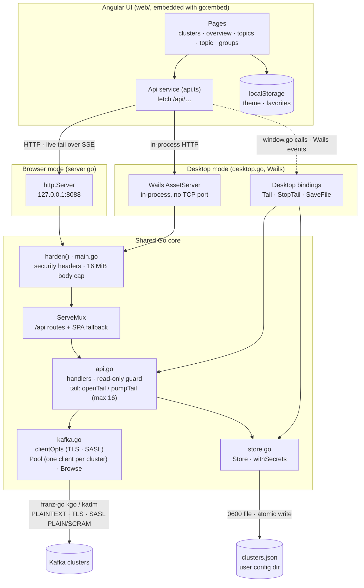
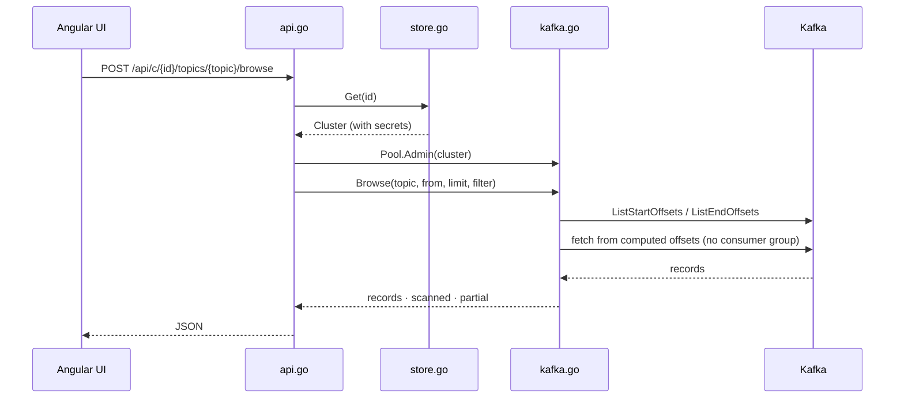
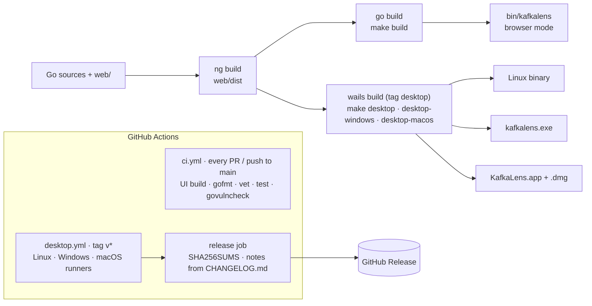

# Architecture

KafkaLens is one Go program with an embedded Angular UI. The same core runs in two modes:
**browser mode** (a local HTTP server, `server.go`) and **desktop mode** (a native Wails window, `desktop.go`).
The build tag `desktop` picks the entry point; everything else is shared.

## Runtime components

| Piece | Role |
|---|---|
| `web/` | Angular UI. Talks only to `/api/…`; in desktop mode it also uses the Wails bridge for live tail and native save dialogs. Theme and favorite topics live in `localStorage`. |
| `server.go` | Browser mode: listens on `127.0.0.1:8088` (`-addr`), opens the default browser. Pure Go, no cgo. |
| `desktop.go` | Desktop mode: serves the same handler through Wails' in-process asset server. Wails buffers whole responses, so live tail goes through Wails events and exports through `SaveFile`. |
| `main.go` | `newHandler()` wires the API and the embedded UI; `harden()` adds CSP and other security headers and caps request bodies. |
| `api.go` | REST routes. `withAdmin` resolves the cluster's admin client; `write` blocks mutations on read-only clusters; `openTail`/`pumpTail` stream new records for both modes. |
| `kafka.go` | franz-go client options (TLS, SASL), a pool with one long-lived client per cluster, and `Browse`, which reads a bounded window of records without joining a consumer group. |
| `store.go` | Saved connections in `clusters.json`. Secrets are never sent to the UI; `withSecrets` reuses a stored password only when brokers and auth settings are unchanged. |

## Request flow: reading messages

## Build and release

