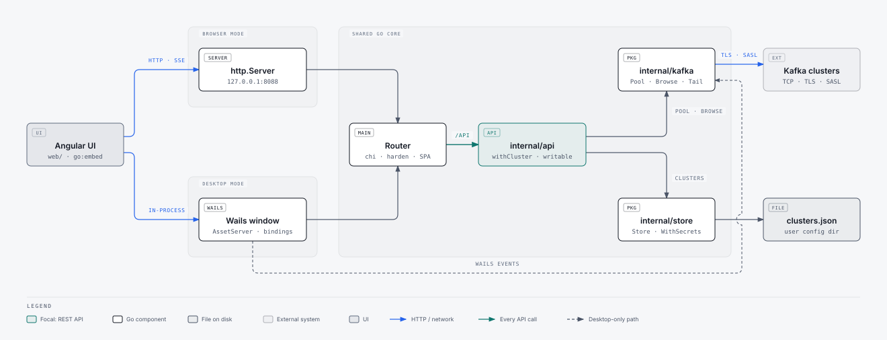
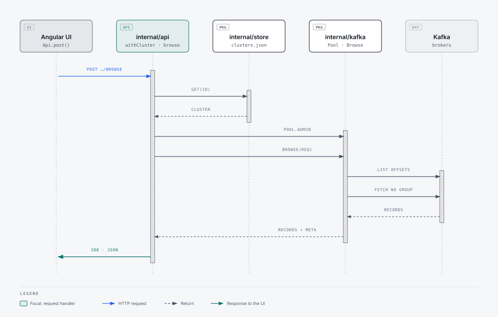
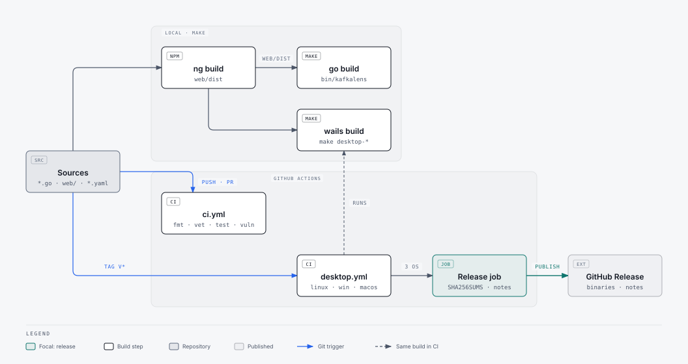

# Architecture

KafkaLens is one Go program with an embedded Angular UI. The same core runs in two modes:
**browser mode** (a local HTTP server, `server.go`) and **desktop mode** (a native Wails window, `desktop.go`).
The build tag `desktop` picks the entry point; everything else is shared.

## Runtime components

<picture>
  <source media="(prefers-color-scheme: dark)" srcset="diagrams/runtime-dark.svg">
  
</picture>

| Piece | Role |
|---|---|
| `web/` | Angular UI. Talks only to `/api/…`; in desktop mode it also uses the Wails bridge for live tail and native save dialogs. Theme and favorite topics live in `localStorage`. |
| `server.go` | Browser mode: listens on `127.0.0.1:8088` (`-addr`), opens the default browser. Pure Go, no cgo. |
| `desktop.go` | Desktop mode: serves the same handler through Wails' in-process asset server. Wails buffers whole responses, so live tail goes through Wails events and exports through `SaveFile`. |
| `config.yaml`, `internal/config` | Startup settings (address, open browser, clusters file, log level), read with viper. Layers: embedded `config.yaml` (defaults) → `./config.yaml` or `-settings` (browser mode only, checked on its own before merging) → `KAFKALENS_<SECTION>_<KEY>` env → flags (browser mode only). Unknown keys, wrong types and invalid values stop the start with a clear error. |
| `logging.go` | [zerolog](https://github.com/rs/zerolog) setup: human-readable lines (`ConsoleWriter`) on the console in both modes, colored only on a terminal, plus `kafkalens.log` next to `clusters.json` in desktop mode (with the date, no colors); level from `log.level` (or `KAFKALENS_LOG_LEVEL`). The standard `log` package (net/http server errors) is routed through it as warnings. `internal/api/log.go` logs one line per API call. |
| `main.go` | `newHandler()` builds the [chi](https://github.com/go-chi/chi) router: mounts the API under `/api` and serves the embedded UI with an SPA fallback; `harden()` adds CSP and other security headers and caps request bodies. |
| `internal/api` | REST routes (`api.go`), with handlers grouped by area: `clusters.go`, `overview.go`, `topics.go`, `messages.go` (browse, live tail over SSE, produce, `template.go`), `groups.go`. The `withCluster` middleware resolves `{id}` to the cluster and its admin client with a 30 s timeout; `writable` blocks mutations on read-only clusters. Handlers return `(value, error)` and `reply` writes the JSON. |
| `internal/kafka` | franz-go client options (TLS, SASL), a pool with one long-lived client per cluster, `Browse`, which reads a bounded window of records without joining a consumer group, and `OpenTail`/`PumpTail`, which stream new records for both modes. |
| `internal/store` | Saved connections in `clusters.json`. Secrets are never sent to the UI; `WithSecrets` reuses a stored password only when brokers and auth settings are unchanged. |

## Request flow: reading messages

<picture>
  <source media="(prefers-color-scheme: dark)" srcset="diagrams/browse-dark.svg">
  
</picture>

## Build and release

<picture>
  <source media="(prefers-color-scheme: dark)" srcset="diagrams/build-dark.svg">
  
</picture>
